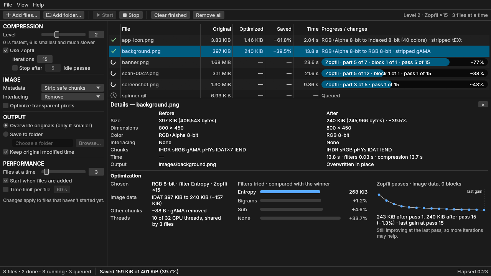

# Oxidrop

A drag-and-drop PNG optimizer for Windows, macOS, and Linux. Drop in PNG, APNG, GIF, or WebP
files and get smaller PNGs back, losslessly, using [oxipng](https://github.com/oxipng/oxipng).



- **Lossless:** the pixels stay the same; only how they're stored changes. An original is only
  replaced when the result is smaller, or results can go to a separate folder instead.
- **Fast on big batches:** several files are optimized at once, sharing the CPU cores.
- **Progress:** each file's progress is accurately estimated from what oxipng is actually doing.
- **See what changed:** sizes, savings, and a details panel with before and after, and how
  oxipng got there.
- **GIF and WebP too:** converted to new PNG files, with animations as APNG. Originals are never
  replaced.

## Download

Download the archive for your system from the [Releases](../../releases) page, extract it, and
run `oxidrop` (`oxidrop.exe` on Windows):

| System                | Archive                       |
|-----------------------|-------------------------------|
| Windows (x86-64)      | `oxidrop-windows-x86_64.zip`  |
| macOS (Apple Silicon) | `oxidrop-macos-arm64.tar.gz`  |
| Linux (x86-64)        | `oxidrop-linux-x86_64.tar.gz` |

The builds aren't code-signed, so the first launch needs one more step:

- **Windows:** if SmartScreen says it protected your PC, choose **More info → Run anyway**.
- **macOS:** run `xattr -d com.apple.quarantine oxidrop` in the folder you extracted it to, or
  allow it in **System Settings → Privacy & Security** after the first attempt.

## Usage

Drop files or folders on the window, or add them from the File menu. Folders are searched for
PNG, APNG, GIF, and WebP files. Files can also be given on the command line:

```sh
oxidrop path/to/images
```

[docs/USAGE.md](docs/USAGE.md) covers the settings, the details panel, keyboard shortcuts, and
where settings and crash logs are kept.

## Building from source

With [Rust](https://rustup.rs) installed (rustup installs the version this project pins):

```sh
cargo build --release
```

The app is `target/release/oxidrop` (`oxidrop.exe` on Windows). On Linux, first install the
development packages listed in [docs/DEVELOPMENT.md](docs/DEVELOPMENT.md), which also covers
tests, checks, and releases.

## License

Oxidrop is licensed under the [MIT License](LICENSE). The crates it's built from have their own
licenses, collected in `THIRD-PARTY-LICENSES.txt` in each release archive, and the Inter
typeface is licensed under the SIL Open Font License (`assets/fonts/Inter-LICENSE.txt`).
